# ☸️ Kubernetes Fundamentals: Deploying and Managing My First Application

This project was my first hands-on dive into Kubernetes.

Rather than jumping directly into a managed service such as Amazon EKS, I wanted to understand what Kubernetes itself is doing first: how Pods are created, how Deployments and ReplicaSets work together, how Services find workloads, how Kubernetes maintains desired state, and what actually happens during scaling and rolling updates.

I built the lab locally using **MicroK8s on Ubuntu 24.04 running in WSL2**.

The project started with a single nginx Pod and gradually evolved into a declaratively managed application with multiple replicas, self-healing, rolling updates, and a stable Kubernetes Service.

---

## 🎯 Project Goals

The goal was to understand the Kubernetes fundamentals behind container orchestration before moving into cloud-managed Kubernetes.

This lab covered:

- Kubernetes cluster basics
- `kubectl`
- Pods
- Deployments
- ReplicaSets
- Labels and selectors
- Services
- EndpointSlices
- Scaling
- Self-healing
- Rolling updates
- Kubernetes YAML
- Declarative configuration
- Desired-state reconciliation
- Basic Kubernetes troubleshooting

---

## 🛠️ Technologies Used

- Kubernetes
- MicroK8s
- kubectl
- nginx
- YAML
- Ubuntu 24.04 LTS
- WSL2
- Visual Studio Code
- Git / GitHub

---

## 🏗️ Architecture

The final application architecture looks like this:

```text
                    Client
                      │
                      │ HTTP :80
                      ▼
              Kubernetes Service
                 nginx-service
                      │
               selector: app=nginx
                      │
                      ▼
                 EndpointSlice
                      │
          ┌───────────┼───────────┐
          ▼           ▼           ▼
        Pod 1       Pod 2       Pod 3
          │           │           │
          └────── nginx:1.28 ─────┘
                      ▲
                      │
                  ReplicaSet
                      ▲
                      │
                  Deployment
               nginx-deployment
```

The **Deployment** defines how the application should be deployed and manages changes to the Pod template.

The **ReplicaSet** maintains the desired number of matching Pods.

The **Pods** run the nginx containers.

The **Service** provides a stable network endpoint and uses labels to locate the appropriate Pods.

---

# Part 1: Learning the Kubernetes Objects

## ☸️ Setting Up the Kubernetes Cluster

I installed MicroK8s inside Ubuntu 24.04 running through WSL2.

After installation, I verified that the cluster was running:

```bash
microk8s status --wait-ready
```

I then checked the node:

```bash
microk8s kubectl get nodes
```

The local Kubernetes cluster contained one Ready node.

I also inspected the Kubernetes system Pods:

```bash
microk8s kubectl get pods --all-namespaces
```

This showed Kubernetes components such as CoreDNS and Calico already running inside the cluster.

---

## 📦 Creating My First Pod

I started by creating a standalone nginx Pod:

```bash
microk8s kubectl run nginx-pod --image=nginx
```

Then verified it:

```bash
microk8s kubectl get pods
```

This introduced one of the first important Kubernetes relationships:

```text
Node
└── Pod
    └── nginx container
```

I then deleted the standalone Pod:

```bash
microk8s kubectl delete pod nginx-pod
```

No Pods remained.

This demonstrated an important distinction:

> A standalone Pod does not automatically have a higher-level controller maintaining its desired state.

---

## 🚀 Deployment → ReplicaSet → Pod

Next, I created nginx through a Deployment:

```bash
microk8s kubectl create deployment nginx-deployment --image=nginx
```

I inspected each layer:

```bash
microk8s kubectl get deployments
microk8s kubectl get replicasets
microk8s kubectl get pods
```

This exposed the Kubernetes controller hierarchy:

```text
Deployment
    ↓
ReplicaSet
    ↓
Pod
    ↓
Container
```

The Deployment manages the application configuration and rollout.

The ReplicaSet maintains the desired number of matching Pods.

---

## 📈 Scaling the Application

I scaled the Deployment from one replica to three:

```bash
microk8s kubectl scale deployment nginx-deployment --replicas=3
```

The ReplicaSet then reported three desired, current, and ready replicas.

All three Pods shared the same ReplicaSet hash while receiving unique Pod suffixes.

This helped demonstrate that Pods are individual workload instances controlled by the same ReplicaSet.

---

## ♻️ Testing Kubernetes Self-Healing

To test self-healing, I intentionally deleted one of the three Pods:

```bash
microk8s kubectl delete pod <pod-name>
```

Because the ReplicaSet still had a desired state of three replicas, Kubernetes immediately created a replacement.

I was able to observe the replacement while it was being created:

```text
READY   STATUS
0/1     ContainerCreating
```

A few seconds later:

```text
READY   STATUS
1/1     Running
```

The behavior looked like this:

```text
Desired = 3
Actual  = 2
     ↓
ReplicaSet detects mismatch
     ↓
New Pod created
     ↓
Desired = 3
Actual  = 3
```

The ReplicaSet did not care about recreating the exact Pod I deleted.

It cared about restoring the **desired number of matching Pods**.

---

## 🏷️ Labels and Selectors

I inspected the labels assigned to the Pods:

```bash
microk8s kubectl get pods --show-labels
```

The Pods shared application and Pod-template labels.

Labels and selectors became especially important once I introduced Kubernetes Services.

A Service does not need to know individual Pod names or Pod IP addresses. Instead, it can dynamically locate Pods based on labels.

---

# Part 2: Kubernetes Networking

## 🌐 Creating a ClusterIP Service

I exposed the Deployment internally using a ClusterIP Service:

```bash
microk8s kubectl expose deployment nginx-deployment --port=80 --type=ClusterIP
```

Then inspected the Service:

```bash
microk8s kubectl get services
```

The Service received a stable ClusterIP.

Unlike Pod IP addresses, which can change when Pods are replaced, the Service provides a consistent endpoint for the application.

---

## 🔗 EndpointSlices

I inspected the Service's backend endpoints:

```bash
microk8s kubectl get endpointslices
```

The EndpointSlice contained the IP addresses of the nginx Pods.

Conceptually:

```text
ClusterIP Service
       │
       ▼
 EndpointSlice
       │
 ┌─────┼─────┐
 ▼     ▼     ▼
Pod   Pod   Pod
```

The Service can remain stable while Kubernetes dynamically maintains the backend Pod membership.

---

## 🧪 Testing the Application

I tested nginx through the Service rather than connecting directly to an individual Pod:

```bash
curl http://<service-cluster-ip>
```

The request successfully returned the nginx page.

This validated the application path:

```text
Client
  ↓
ClusterIP Service
  ↓
EndpointSlice
  ↓
Pod
  ↓
nginx container
  ↓
HTTP response
```

The ClusterIP used in this project is intended for **internal Kubernetes networking**.

I intentionally did not expose the application externally with NodePort, LoadBalancer, or Ingress because the goal of this project was to understand the Kubernetes fundamentals first.

---

# Part 3: Rolling Updates

## 🔄 Before the Update

Before changing the application image, I inspected the existing ReplicaSet.

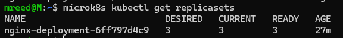

This gave me a baseline showing the ReplicaSet responsible for the original nginx Pods.

---

## 🚀 Updating nginx

I updated the Deployment to use nginx 1.28:

```bash
microk8s kubectl set image deployment/nginx-deployment nginx=nginx:1.28
```

Instead of stopping all three existing Pods and then starting new ones, Kubernetes performed a rolling update.

I was able to capture the rollout while it was happening.

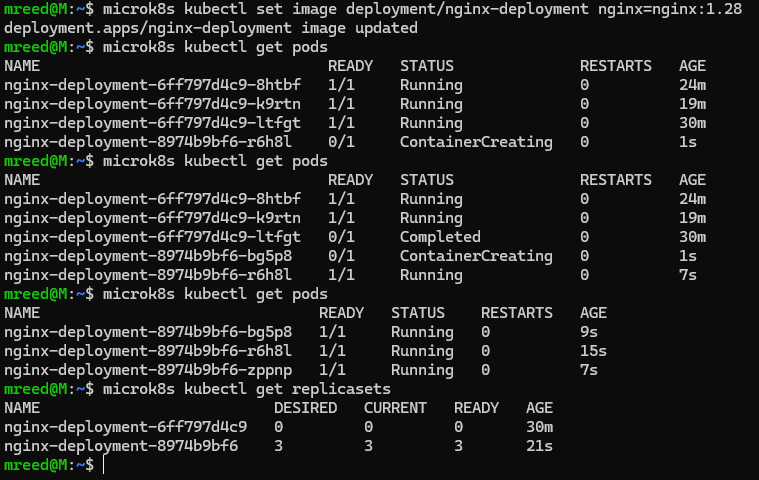

During the transition, old Pods remained available while new Pods were created.

Conceptually:

```text
                 Deployment
                     │
          ┌──────────┴──────────┐
          ▼                     ▼
   Old ReplicaSet         New ReplicaSet
          │                     │
     scale down              scale up
          │                     │
        Pods                  Pods
```

This demonstrated how Kubernetes can update an application gradually instead of replacing every running instance simultaneously.

---

## ✅ Verifying the New Image

After the rollout completed, I verified that the Deployment was running:

```text
nginx:1.28
```

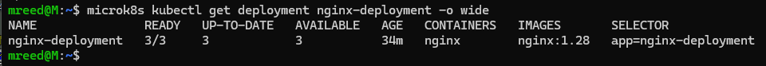

The Deployment now managed the new application revision while the previous ReplicaSet remained available as part of the Deployment's rollout history.

---

## 🔎 Inspecting the Rolling Update

I inspected the Deployment using:

```bash
microk8s kubectl describe deployment nginx-deployment
```

The output showed information including:

- Desired replicas
- Updated replicas
- Available replicas
- `nginx:1.28`
- `RollingUpdate` strategy
- Old and new ReplicaSets
- Deployment controller events

The events were particularly useful because they showed Kubernetes gradually scaling the new ReplicaSet up while scaling the old ReplicaSet down.

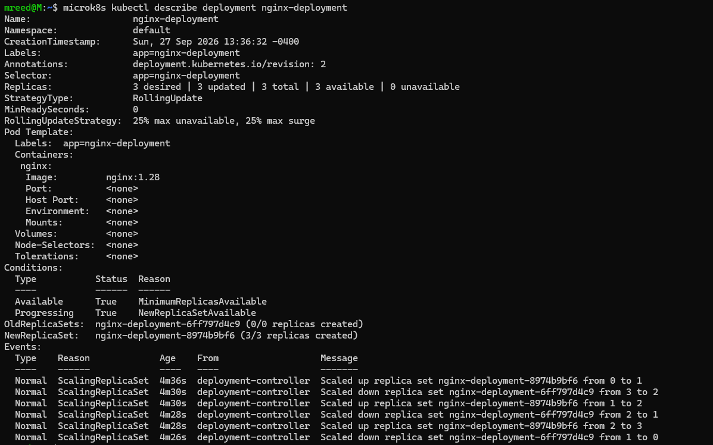

This helped clarify the different responsibilities:

```text
Deployment
    ↓
Manages application changes and rollouts

ReplicaSet
    ↓
Maintains the required Pod count
```

---

## 🌐 Stable Service, Changing Pods

After the rolling update, I inspected the EndpointSlice again.

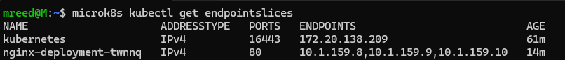

The backend Pod IP addresses had changed because the old Pods were replaced by Pods from the new ReplicaSet.

The Service itself remained stable.

I tested the application again through the Service:

```bash
curl http://<service-cluster-ip>
```

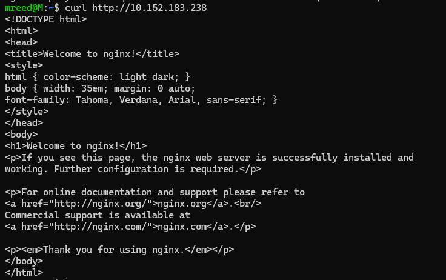

nginx continued responding successfully.

This demonstrated an important Kubernetes networking concept:

> The Pods behind an application can change while clients continue using the same stable Service endpoint.

---

# Part 4: Moving to Declarative Kubernetes

## 📄 From Commands to YAML

Up to this point, I intentionally used imperative commands while learning what each Kubernetes object did:

```bash
kubectl create
kubectl scale
kubectl expose
kubectl set image
```

Next, I moved the application into declarative Kubernetes YAML.

Instead of documenting a series of commands that must be repeated manually, I defined what I wanted the environment to look like.

The project contains:

```text
deployment.yaml
service.yaml
```

---

## 📄 Deployment Configuration

The Deployment defines three nginx replicas using nginx 1.28:

```yaml
apiVersion: apps/v1
kind: Deployment

metadata:
  name: nginx-deployment

spec:
  replicas: 3
  selector:
    matchLabels:
      app: nginx

  template:
    metadata:
      labels:
        app: nginx
    spec:
      containers:
        - name: nginx
          image: nginx:1.28
          ports:
            - containerPort: 80
```

One of the most important relationships in the YAML is:

```yaml
selector:
  matchLabels:
    app: nginx
```

matching:

```yaml
template:
  metadata:
    labels:
      app: nginx
```

The Deployment uses that selector to identify the Pods belonging to it.

---

## 📄 Service Configuration

The Service provides a stable ClusterIP endpoint:

```yaml
apiVersion: v1
kind: Service

metadata:
  name: nginx-service

spec:
  type: ClusterIP

  selector:
    app: nginx

  ports:
    - protocol: TCP
      port: 80
      targetPort: 80
```

The Service selector:

```yaml
selector:
  app: nginx
```

matches the Pod label:

```yaml
labels:
  app: nginx
```

The resulting linkage is:

```text
Deployment selector
      app: nginx
          │
          │ matches
          ▼
Pod labels
      app: nginx
          ▲
          │ matches
          │
Service selector
      app: nginx
```

This was one of the most important concepts I learned during the project.

A Kubernetes environment can have healthy running Pods and a Service that still cannot reach them if the Service selector does not match the Pod labels.

---

# Part 5: Validation and Troubleshooting

## 🧪 Server-Side Dry Run

Before applying the YAML, I validated it against the Kubernetes API:

```bash
microk8s kubectl apply --dry-run=server -f deployment.yaml
```

and:

```bash
microk8s kubectl apply --dry-run=server -f service.yaml
```

The Service configuration validated successfully.

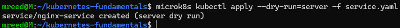

Server-side dry run allowed Kubernetes to process the configuration without persisting the changes.

This provided a useful validation step before modifying the actual environment.

---

## ⚠️ Troubleshooting an Immutable Selector

The Deployment validation uncovered a real problem:

```text
spec.selector: Invalid value:
field is immutable
```

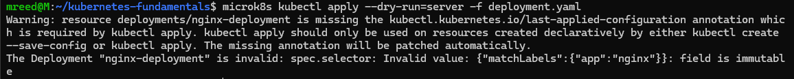

The original Deployment had been created imperatively and used:

```text
app=nginx-deployment
```

My new YAML defined:

```text
app=nginx
```

The Deployment selector determines which Pods belong to the Deployment and cannot simply be changed after the Deployment has been created.

Instead of forcing the existing environment into the new configuration, I removed the manually created learning resources and rebuilt the application cleanly from YAML.

This was a useful troubleshooting lesson:

> A valid YAML file can still conflict with the state or immutable properties of an existing Kubernetes resource.

---

# Part 6: Rebuilding the Application From YAML

## 🚀 Applying the Declarative Configuration

After cleaning up the manually created Deployment and Service, I recreated the application with:

```bash
microk8s kubectl apply -f deployment.yaml
microk8s kubectl apply -f service.yaml
```

Then inspected everything together:

```bash
microk8s kubectl get deployments,replicasets,pods,services
```

Kubernetes created the application architecture from the YAML:

```text
deployment.yaml
      │
      ▼
Deployment
      │
      ▼
ReplicaSet
      │
 ┌────┼────┐
 ▼    ▼    ▼
Pod  Pod  Pod


service.yaml
      │
      ▼
ClusterIP Service
      │
      ▼
Matching Pods
```

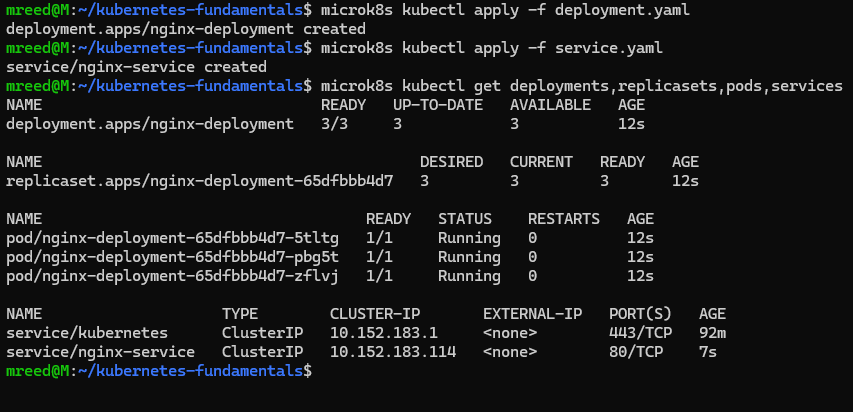

The individual Pod names and ReplicaSet hash were different from the earlier manually created resources, but that did not matter.

The **desired architecture** was recreated successfully.

---

## 🌐 Validating the Declarative Build

I inspected the EndpointSlice again:

```bash
microk8s kubectl get endpointslices
```

The new Service discovered the newly created Pods.

I then tested the new ClusterIP:

```bash
curl http://<service-cluster-ip>
```

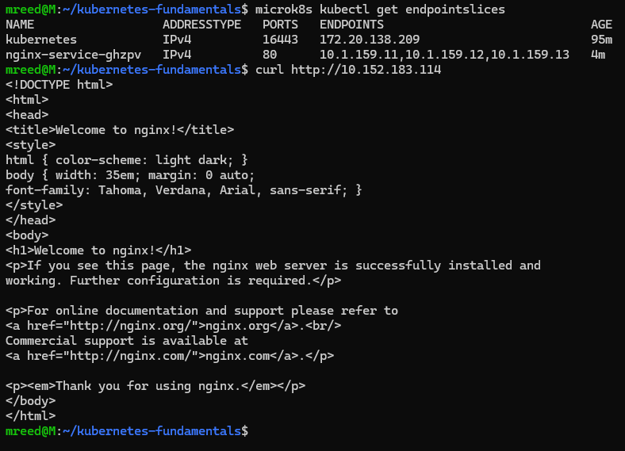

This confirmed the complete declarative path:

```text
YAML
 ↓
Deployment
 ↓
ReplicaSet
 ↓
Pods
 ↓
Pod labels
 ↓
Service selector
 ↓
EndpointSlice
 ↓
nginx
 ↓
HTTP response
```

---

# Part 7: Declarative Scaling

## 📉 Scaling From Three Replicas to Two

To reinforce the desired-state model, I edited:

```yaml
replicas: 3
```

to:

```yaml
replicas: 2
```

Then ran:

```bash
microk8s kubectl apply -f deployment.yaml
```

I did not manually delete a Pod or run `kubectl scale`.

I only changed the desired state in the YAML.

Kubernetes reconciled the environment:

```text
Desired = 2
Actual  = 3
      ↓
ReplicaSet scales down
      ↓
Desired = 2
Actual  = 2
```

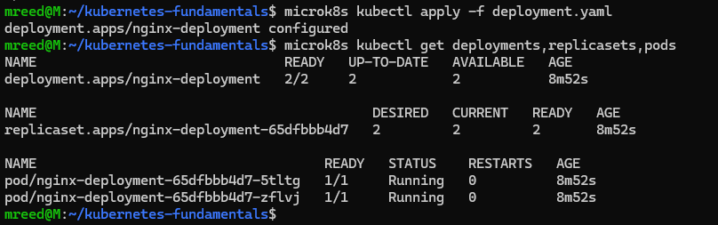

Because I changed only the number of replicas and did not change the Pod template, Kubernetes continued using the same ReplicaSet.

---

## 📈 Scaling Back to Three Replicas

I changed the YAML back to:

```yaml
replicas: 3
```

and applied it again:

```bash
microk8s kubectl apply -f deployment.yaml
```

The ReplicaSet detected that only two Pods existed and created a third.

The new Pod received its own unique suffix and had an age of only a few seconds while the existing Pods remained running.

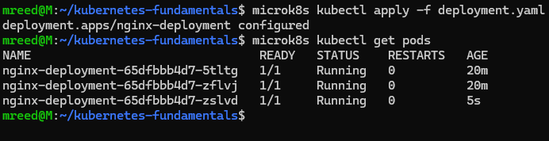

This reinforced one of the biggest concepts from the lab:

> I declare the state I want. Kubernetes determines how to get there.

---

# 🧠 Imperative vs Declarative Kubernetes

This project helped clarify the difference between two approaches.

## Imperative

Tell Kubernetes what action to perform:

```bash
kubectl scale deployment nginx-deployment --replicas=3
```

## Declarative

Describe what the environment should look like:

```yaml
spec:
  replicas: 3
```

Then apply the desired state:

```bash
kubectl apply -f deployment.yaml
```

Kubernetes determines how to reconcile the actual environment with the declared configuration.

This connects closely with the Infrastructure as Code mindset I have been practicing with Terraform:

```text
Define desired state
        ↓
Compare with actual state
        ↓
Determine required changes
        ↓
Reconcile the environment
```

---

# 🔍 Troubleshooting Approach

One of my goals with this project was to understand more than simply how to get nginx running.

I wanted to understand how the pieces connect so I could troubleshoot the path when something does not work.

A useful troubleshooting path from this lab is:

```text
Application
     ↓
Container
     ↓
Pod
     ↓
ReplicaSet
     ↓
Deployment
     ↓
Labels / Selectors
     ↓
Service
     ↓
EndpointSlice
     ↓
Network path
```

Some of the commands I used throughout the project included:

```bash
# Cluster
microk8s status --wait-ready
microk8s kubectl get nodes

# Pods
microk8s kubectl get pods
microk8s kubectl get pods -o wide
microk8s kubectl get pods --show-labels
microk8s kubectl get pods --all-namespaces

# Deployments
microk8s kubectl get deployments
microk8s kubectl describe deployment nginx-deployment

# ReplicaSets
microk8s kubectl get replicasets

# Networking
microk8s kubectl get services
microk8s kubectl get endpointslices

# Application testing
curl http://<service-cluster-ip>

# Declarative configuration
microk8s kubectl apply --dry-run=server -f deployment.yaml
microk8s kubectl apply -f deployment.yaml
microk8s kubectl apply -f service.yaml
```

---

# 💡 Key Takeaways

## Pods are disposable

Individual Pods are not something I should depend on remaining alive forever.

Higher-level Kubernetes controllers maintain the desired application state and replace Pods when necessary.

## ReplicaSets maintain quantity

The ReplicaSet makes sure the desired number of matching Pods exists.

```text
Desired = 3
Actual  = 2
      ↓
Create another Pod
```

## Deployments manage application changes

Deployments sit above ReplicaSets and manage the Pod template and rollout process.

Changing the Pod template, such as changing the container image, can create a new ReplicaSet and trigger a rolling update.

## Services provide stable networking

Pod names and IP addresses can change.

Services provide a stable endpoint and use selectors to dynamically locate matching Pods.

## Labels create relationships

Kubernetes resources do not need to depend on specific Pod names.

Labels and selectors allow resources such as Deployments and Services to dynamically associate with the appropriate Pods.

## Running does not automatically mean reachable

Seeing:

```text
STATUS: Running
```

tells me Kubernetes sees the container running.

Testing with:

```bash
curl
```

validates that the application can actually be reached through the expected network path.

## Desired state is the Kubernetes mindset

Rather than manually maintaining individual Pods:

```text
Declare desired state
        ↓
Kubernetes observes actual state
        ↓
Difference detected
        ↓
Controllers reconcile
        ↓
Actual state matches desired state
```

---

# 🐳 Connecting Docker Knowledge to Kubernetes

My previous Docker and Docker Swarm projects helped make several Kubernetes concepts familiar.

Docker taught me:

- Images
- Containers
- Container ports
- Container lifecycle

Docker Swarm introduced:

- Services
- Replicas
- Desired state
- Self-healing
- Container rescheduling
- Orchestration

Kubernetes builds on those ideas with additional abstractions:

```text
Deployment
    ↓
ReplicaSet
    ↓
Pod
    ↓
Container
```

This project helped connect my existing container knowledge to Kubernetes orchestration rather than treating Kubernetes as an entirely separate technology.

---

# 📁 Repository Structure

```text
kubernetes-fundamentals/
│
├── .gitignore
├── deployment.yaml
├── service.yaml
├── README.md
│
└── screenshots/
    ├── 01-replicaset-before-rolling-update.png
    ├── 02-deployment-nginx-1-28.png
    ├── 03-rolling-update-in-progress.png
    ├── 04-deployment-nginx-1-28.png
    ├── 05-deployment-describe-rolling-update-events.png
    ├── 06-endpoints-after-rolling-update.png
    ├── 07-nginx-service-curl-after-update.png
    ├── 08-immutable-selector-validation-error.png
    ├── 09-service-yaml-server-dry-run.png
    ├── 10-declarative-yaml-deployment-and-service.png
    ├── 11-declarative-service-endpoints-and-curl.png
    ├── 12-yaml-scale-down-to-two-replicas.png
    └── 13-yaml-scale-up-to-three-replicas.png
```

---

# 🚀 What's Next

This project intentionally focused on Kubernetes itself before adding cloud-provider abstractions.

Future Kubernetes labs can build on this foundation with:

- ConfigMaps
- Secrets
- Liveness and readiness probes
- Resource requests and limits
- Persistent storage
- Namespaces
- Kubernetes DNS
- Ingress
- Helm
- Monitoring and observability
- Multi-node Kubernetes
- Amazon EKS

---

# 🎯 Final Result

I started this project with a single nginx Pod and ended with a declaratively managed Kubernetes application:

```text
                 nginx-service
                 ClusterIP :80
                       │
                selector: app=nginx
                       │
                       ▼
                  EndpointSlice
                       │
             ┌─────────┼─────────┐
             ▼         ▼         ▼
           Pod       Pod       Pod
             \         |         /
              \        |        /
                 ReplicaSet
                     ▲
                     │
                  Deployment
```

Along the way I:

- Created and deleted standalone Pods
- Built a Deployment
- Inspected its ReplicaSet
- Scaled the application
- Intentionally deleted a Pod and observed self-healing
- Created a ClusterIP Service
- Inspected EndpointSlices
- Validated the application with `curl`
- Performed and observed a rolling update
- Inspected Deployment controller events
- Encountered and diagnosed an immutable selector error
- Moved from imperative commands to declarative YAML
- Rebuilt the application entirely from configuration files
- Scaled down and back up by changing desired state in YAML

The biggest lesson from the project:

> **With Kubernetes, I am not trying to protect individual Pods. I am defining the application state I want, and Kubernetes continuously works to keep the environment there.** ☸️